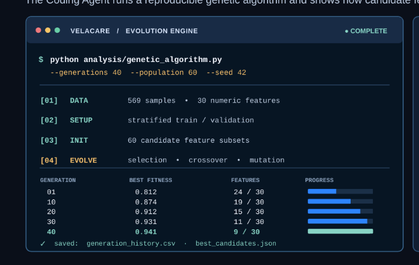

# Codex Goal: Build the VelaCare Evolution Engine

## Outcome

Implement, run, test, and document a **working Python genetic-feature-selection application** for the VelaCare Research demo on Citrix SecurSpaces (GCP). Analyze the Wisconsin Breast Cancer Diagnostic dataset using an evolutionary algorithm, display real progress in a **branded Rich-based TUI that closely matches the attached screenshot**, and write all experimental state to the shared `/agentic-space/` filesystem for the Data Explorer dashboard and Report Agent.

**Two equally important products must emerge:**
1. A trustworthy, reproducible scientific computation with a visually compelling terminal experience.
2. A durable, **generation-by-generation and candidate-by-candidate experiment record** that downstream tools can reconstruct and explore **without rerunning the genetic algorithm**.

**Design principle (non-negotiable):** **The dashboard must be able to reconstruct *any generation* of *any saved experiment*, including its entire population, selected-feature chromosomes, best/mean fitness, diversity, selection/crossover/mutation lineage, and relevant classifier metrics. Saving only the best final model or sparse snapshots is not sufficient.**

The future dashboard and Report Agent are other applications in the **same Agentic Space**. They must be able to read the same paths directly. Do not build a file-transfer protocol, synchronization service, cloud storage layer, or separate sharing API.

## Visual reference and design acceptance



**Required reference asset:** `assets/velacare-evolution-tui-reference.png`

Before implementing the TUI, open and inspect this image. Treat it as the *design reference* for visual hierarchy, panel layout, Rich colors, named computation phases, progress bars, aligned metrics, spacing, status, and final saved-file line. It is **not** a source of genuine experiment results; numbers visible in the screenshot are fictitious mock data.

The app must recreate these elements visually, within normal terminal constraints:

- Header `VELACARE / EVOLUTION ENGINE` plus `RUNNING`, `COMPLETE`, or `FAILED` status.
- Dark/navy-friendly color palette; blue progress bars; teal successful phases; amber active phase; readable high-contrast text. Use Rich `Live`, `Panel`, `Table`, `Progress` or equivalent.
- Four phases: `[01] DATA`, `[02] SETUP`, `[03] INIT`, `[04] EVOLVE`.
- During evolution show **current generation / total**, best fitness, selected features (`N / 30`), progress, average fitness, elapsed time; avoid screen-flooding repeated lines.
- For the finished run show selected generations and a concise real metrics summary; show which files were saved.
- Support smaller terminal widths and `--no-color`; do not require a specific terminal theme or true background color support. Do not hardcode screenshot values.
- Display **real** counts, timings, results, and progress sourced from the algorithm.

## Dataset

Source: UCI Machine Learning Repository, Breast Cancer Wisconsin (Diagnostic), dataset ID **17**.
https://archive.ics.uci.edu/dataset/17/breast+cancer+wisconsin+diagnostic

- Download automatically on first run, preferably using `ucimlrepo`; `--download-only` fetches and validates without running evolution.
- Persist normalized data at `/agentic-space/data/breast_cancer.csv` and provenance metadata. Reuse the cache on later runs.
- Validate **569 samples**, **30 numeric features**, **two classes** (malignant, benign); preserve the feature order, feature names and label mapping.
- When `/agentic-space` is unavailable locally, default to a repository-local `./agentic-space`; allow `--workspace PATH` to override the root.
- Handle offline or failed download with a clear error and recovery message.

## Genetic algorithm

Implement a real population-based genetic algorithm, **not a simulated animation**:

1. Represent each candidate as a 30-bit mask selecting a subset of features; prohibit or penalize an all-zero mask.
2. Initialize a seeded population of random masks.
3. Fit a pipeline with training-only preprocessing and a fast classifier such as scikit-learn logistic regression.
4. Evaluate a candidate on **stratified cross-validation inside a stratified training split**. Never use the held-out test set to choose features or fitness.
5. Define and document an explicit, interpretable fitness function rewarding predictive quality (particularly malignant-class sensitivity) while penalizing unnecessary features.
6. Implement selection, crossover, mutation and elitism. Record parent IDs and operator information for offspring when possible.
7. Repeat for `--generations` and preserve best/mean fitness, classifier metrics, population statistics and feature selection at **every generation**.
8. Evaluate the selected final candidate on the untouched held-out test set, save a confusion matrix and clearly separate CV metrics from hold-out metrics.
9. Make runs reproducible using the specified seed, deterministic evaluation where feasible, and captured package versions. Document any remaining nondeterminism.
10. Ensure `--generations 40 --population 60 --seed 42` is practical for a live demo on CPU; use performance improvements that do not undermine correctness (e.g. cached evaluation of identical chromosomes).

Do **not** frame results as clinically validated. This is an educational/research demonstration, not a medical diagnostic tool. The algorithm evolves feature selections, **not biological cancer mutations**.

## Command-line interface and launcher

Create an executable repository-root shortcut:

```bash
./run-demo --generations 40 --population 60 --seed 42
```

Support:

| Option | Behavior |
|---|---|
| `--generations` | Positive integer; full number of generations |
| `--population` | Population size |
| `--seed` | Reproducible RNG seed |
| `--mutation-rate` | Probability of bit mutation |
| `--crossover-rate` | Probability of crossover |
| `--workspace` | Override the shared filesystem root |
| `--download-only` | Download + validate dataset then exit |
| `--no-color` | Disable ANSI terminal colors |
| `--help` | Usage and examples |

Prefer Python **3.11+**, `pyproject.toml` plus a reproducible dependency lockfile; installation must make `./run-demo` work without requiring users to manually activate a virtualenv. Keep data fetching, GA logic, model evaluation, persistence, TUI, and CLI separately testable.

## Shared filesystem and durable output contract

Use the following paths, where `WORKSPACE` means the effective root (normally `/agentic-space`):

```text
WORKSPACE/
├── data/
│   ├── breast_cancer.csv
│   └── dataset_metadata.json
└── analysis/
    ├── experiments/
    │   ├── latest.json
    │   ├── run_001/
    │   │   ├── run_manifest.json
    │   │   ├── generation_history.csv
    │   │   ├── candidate_history.jsonl
    │   │   ├── best_candidates.json
    │   │   └── model_metrics.json
    │   ├── run_002/
    │   │   └── ...
    │   └── ...
    └── genetic_algorithm.py      # optional convenience module/entry point
```

### The **full-history** data requirement: no skipped generations, no missing candidate populations

Implement a **documented, versioned output schema**. For **each generation** (including generation 1 and the last generation), persist:

- The population size and **one full record for every evaluated candidate**, not just the winner; identify a candidate with an unambiguous `(run_id, generation, candidate_id)` key.
- Each candidate's **30-bit chromosome in stable UCI feature order** (as an array of 0/1 or a clearly documented 30-character string), exact selected feature names and count, fitness and component metrics.
- Generation number, seed/run ID, candidate identity, optional parent IDs and genetic operator (`initial`, `elite`, `crossover`, `mutation`, or combination) to visualize evolution and lineage.
- Best and mean fitness, min/median fitness, feature count for best candidate, population diversity (e.g. distinct-mask count, entropy or average Hamming distance), and elapsed time.
- All intermediate results **while the run is progressing**, with safe writes/flushes and a clear manifest status so consumers can tell which generations are complete.

**Crucial invariant:** After the run finishes, a dashboard should be able to load `run_001` from disk, select **generation 17** (or any other generation), and reconstruct every chromosome shown on that generation, the population fitness distribution and the winning subset **without executing the GA or model again**. It must then be able to compare this with generation 17 or generation 50 from another run.

File contracts:

- `generation_history.csv`: exactly one row per complete generation, including generation, population statistics, selected features, best and mean fitness, diversity, timing, and identifiers for its best candidate.
- `candidate_history.jsonl`: full evaluated candidate population for each generation (recommended: one record per `(generation, candidate_id)`); include chromosome, selected features, fitness, CV metrics and ancestry/operator metadata. No sampled records or top-N-only records.
- `best_candidates.json`: best candidate snapshot at every generation, including full chromosome and selected names. Can also contain final-best summary.
- `model_metrics.json`: final CV metrics and **separately labeled held-out test metrics**; accuracy, balanced accuracy, malignant sensitivity, specificity, and confusion matrix.
- `run_manifest.json`: `schema_version`, run ID, dataset identity/checksum, feature order, parameters, seed, classifier/CV configuration, software versions, timestamps, run status and the last fully committed generation.
- `latest.json`: pointer to latest run (preferably to its manifest) without copying data from the run.

Write runs under new, stable `run_NNN` directories. **Never overwrite an existing run.** On interrupted runs, retain valid completed generations, mark the run `interrupted`/`failed`, and do not present incomplete generations as complete. Use safe atomic replacement for per-run summary files. `candidate_history.jsonl` may append, but must flush records correctly and provide a coherent visibility boundary per generation.

Do not introduce network calls between the GA and dashboard/report. Their contract is **the directory structure and file schemas**.

## Downstream Data Explorer requirements

These are **contract requirements for the data produced by this task**; implementing the dashboard itself is outside this goal.

Saved data must support, without re-executing experiments:

- Best and mean fitness curves across all generations.
- A slider selecting any generation and showing that generation's **complete candidate population**.
- A 30-column heatmap of every candidate's chromosome for the selected generation (not just one mask).
- Highlight the best candidate's features and its 30-bit selection mask.
- Population diversity, selected-feature-count distribution and fitness distribution at selected generation.
- Changes in best candidate selection/feature frequency across generations.
- CV versus held-out metrics clearly distinguished.
- Side-by-side comparison of multiple runs such as 40 versus 80 generations.

## Testing and verification

Implement automated tests for:

- Dataset shape, feature ordering and label mapping.
- Chromosome validity, selection, crossover, mutation and elitism.
- Reproducibility with identical seeds/parameters.
- No training/test leakage.
- Correct schema version and data fields.
- **History completeness:** with `G` generations and `P` evaluated candidates per generation, verify `G` complete generation summaries and `G × P` candidate snapshot records (or explicitly document and test the chosen handling of elite/reused candidate evaluations). All generations must reconstruct correctly.
- Exact candidate chromosome ↔ selected features mapping.
- Resume/interrupt behavior or at least retention of completed generations after interruption.
- End-to-end smoke run with small `--generations` and `--population`, followed by a test that reconstructs several generations **from files alone**.
- Rich TUI successful termination and `--no-color` mode.

## Acceptance criteria / definition of done

- [ ] Dataset downloads/caches and validates at 569 rows × 30 features.
- [ ] `./run-demo --generations 40 --population 60 --seed 42` runs on a clean installation.
- [ ] TUI closely follows `assets/velacare-evolution-tui-reference.png` and uses actual algorithm data.
- [ ] All 40 generations have complete, discoverable state, including all 60 candidate chromosomes and their metrics, available to reconstruct without computation.
- [ ] Output files appear incrementally, and an unfinished run is explicitly marked.
- [ ] Two runs (40 and 80 generations) coexist in the same filesystem; `latest.json` points to newest.
- [ ] Dashboard-facing schema is documented with a minimal file-only read/reconstruction example.
- [ ] Identical configuration and seed reproduce algorithm results.
- [ ] Tests pass; implementation README covers installation, launching, output schema, and dataset attribution.
- [ ] Running the project emits no fabricated fitness numbers or misleading clinical claims.

**Instructions to Codex:** Inspect the repository, then implement and test the software. Do not stop after writing a plan. Actually run an example and show the produced data files, TUI output, test results, and a demonstration that an arbitrary historical generation can be reconstructed from the saved outputs alone. Preserve pre-existing repository files unless changes are necessary and justified. Do not push to GitHub or deploy unless explicitly asked.
