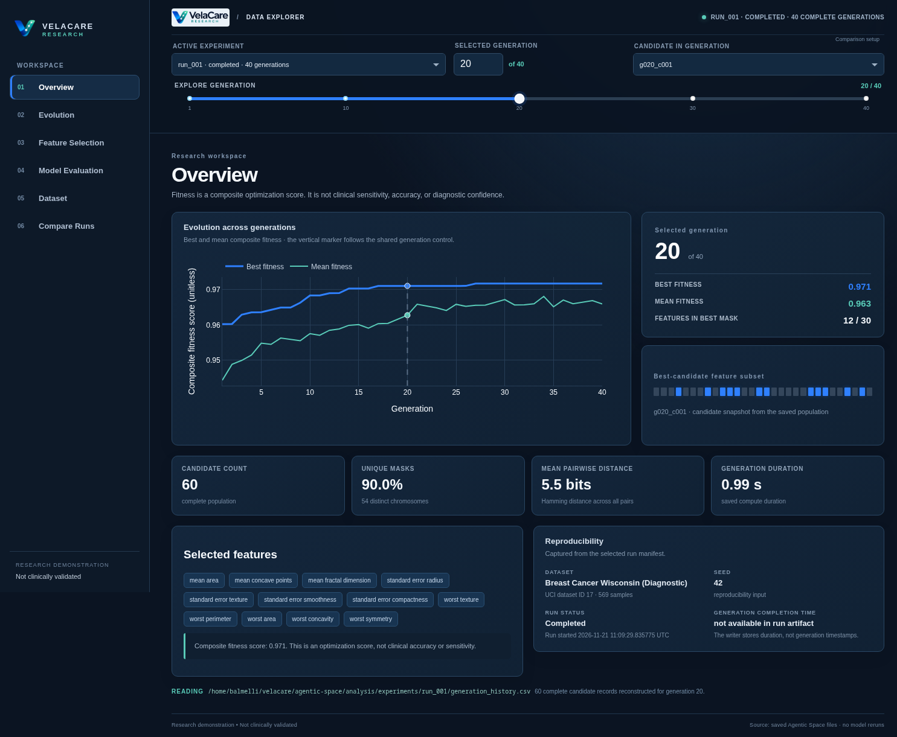
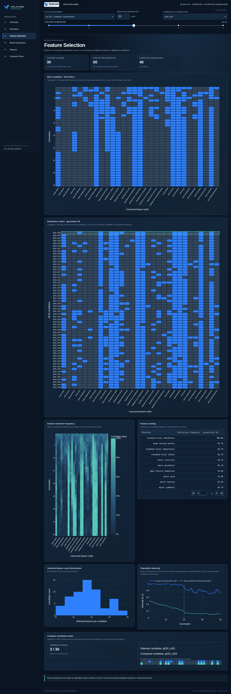
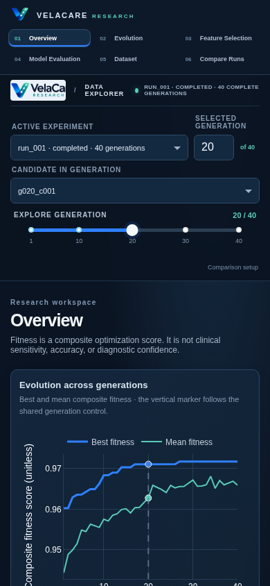

# Running VelaCare Data Explorer

## Application

The Data Explorer is a Plotly Dash application inside the existing `velacare` Python package. It reads saved files directly from the workspace and does not load the classifier, run the GA, or contact UCI. A generation becomes visible only after `run_manifest.json` advances `last_fully_committed_generation` and the complete candidate population and summary validate.

## Repository layout

- Working Python application: `src/velacare/`.
- Existing CLI: `./run-demo`.
- Dashboard Python modules: `src/velacare/dashboard/`.
- Dashboard launcher: `./run-dashboard`.
- Shared persistent data root: `./agentic-space/` during development, `/agentic-space/` when deployed.
- Current runs: `./agentic-space/analysis/experiments/`.
- Visual references: `assets/data-explorer-reference.png`, `assets/feature-evolution-reference.png`.

## Prepare environment

Python 3.11+ and `uv` are required. The dashboard and report packages are optional extras in the existing project; they use the repository's existing `.venv` and `uv.lock`.

```bash
uv sync --extra dashboard --extra report --group dev
```

`./run-dashboard` also resolves the dashboard extra through the existing lock on first use. No second application environment is created.

## Start the genetic algorithm

```bash
cd ~/velacare
./run-demo --generations 40 --population 60 --seed 42
```

## Start the dashboard

```bash
cd ~/velacare
./run-dashboard --workspace ./agentic-space --host 127.0.0.1 --port 8050
```

Open `http://127.0.0.1:8050` in a browser. `--workspace /agentic-space` selects the deployment path when all applications share that mounted workspace; do not add file-copy or sync steps.

For an ingress that preserves a URL prefix, add `--base-path /research/` and route that prefix to the dashboard process.

The server exposes minimal `GET /health/live` and `GET /health/ready` routes (under the configured base path). Readiness stays healthy when the experiment directory is empty; it becomes unavailable if initialization fails or the configured workspace cannot be accessed. The routes return a VelaCare service marker for local process checks and omit absolute paths and artifact contents. A production gateway should decide whether to expose these anonymous health checks publicly or restrict them to its own probes.

The optional startup activation adapter is disabled by default and does not make network requests. `--activation-mode mock` opts into a local, simulated state machine for UI demonstrations; it does not wake a real workspace. See the [ChromeOS and PWA setup guide](PWA_CHROMEOS_SETUP.md) for the adapter boundary and deployment limits.

The initial view is **Overview**. The permanent navigation provides Overview, Evolution, Feature Selection, Model Evaluation, Dataset and Compare Runs. The run, numeric generation input and slider are synchronized with candidate selection. Click a row in the history or population heatmap to change the shared generation or candidate. All values come from persisted run records, not the illustrative screenshots.

The Evolution page shows every candidate in the selected generation, the fitness distribution, full record table, stored CV components, parent/operator metadata and a chromosome comparison. Feature Selection includes a best-candidate matrix for every committed generation, a complete candidate × feature matrix for the selected generation, frequency heatmaps and diversity computed from stored chromosomes.

## Live evolution and comparison

When the selected run has `status: running`, the dashboard checks the local manifest every two seconds. It reads only complete committed generations, increases the slider maximum, and retains the selected generation. The refresh timer stops when the selected run is idle. Compare any two discovered runs with the controls under “Comparison setup”; different datasets, fitness formulas, models, validation designs, or seeds are surfaced as comparability caveats.

## Missing data and troubleshooting

Run history issues appear in the run selector and selected-run error state. Missing or malformed candidate-level records are reported; candidate populations are never synthesized from summary rows. The app reads `agentic-space/data/breast_cancer.csv` and its metadata only. Missing dataset data is shown as a local data error; the dashboard does not fetch a replacement.

The evaluation page shows saved cross-validation and held-out test results in separate panels. Unsupported metrics display “not available in run artifact.” Fitness stays labeled as a dimensionless composite optimization score throughout the application.

## Screenshots

The screenshots below use saved run `run_001`, generation 20 of 40, and its full stored population. Values are sourced from the workspace artifacts.







For reporting setup see [OpenCode Report Agent Setup](OPENCODE_SETUP.md). Not clinically validated.
